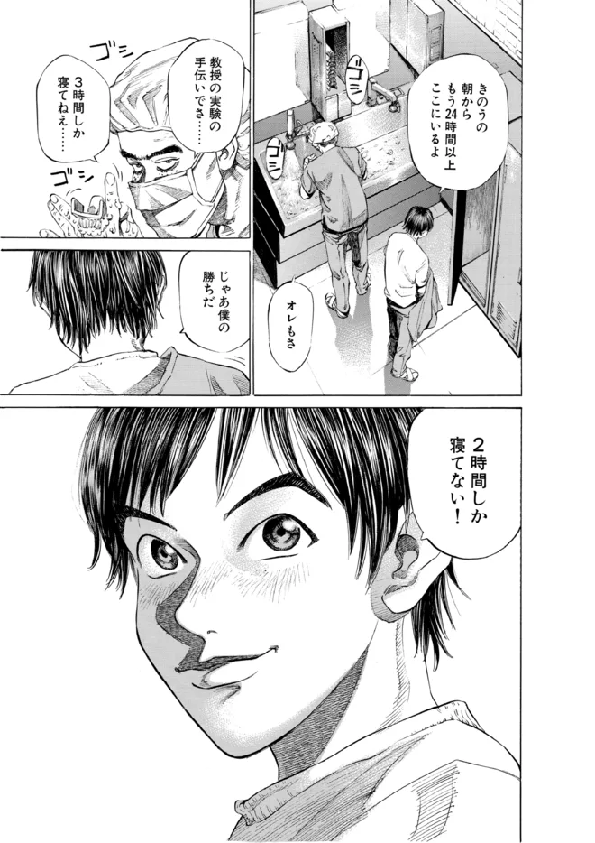

  

<h1 align="center">Serifu</h1>

  AI manga translator: whole volumes, lettered into the bubbles. 
  <a href="https://serifu.net/">Website</a> ·
  <a href="https://serifu.net/docs">Docs</a> ·
  <a href="https://serifu.net/pricing">Pricing</a> ·
  <a href="https://serifu.net/download">Download</a> ·
  <a href="https://serifu.net/changelog">Changelog</a>

This repository is where Serifu takes bug reports and ideas, and where the plan for what comes next is kept. The
app's source code is not here.

## What Serifu does

Serifu translates the manga, manhwa, manhua and comics you own and gives each page back lettered: the original
text removed, the translation set inside its bubble.

| Original | Translated by Serifu |
|---|---|
|  |  |

- **A whole volume at once.** Pages are translated in reading order, each with the two pages before it, so
  speakers, names and numbers stay right across the volume.
- **Lettered into the bubbles.** Each line is set inside its own bubble, where the original text was.
- **Fix a line, see it lettered.** Change a translation and the page is lettered again.
- **Nothing to set up.** No graphics card, no models to download, no API keys.
- **Reads** Japanese (vertical and horizontal), Korean, Chinese and English; **translates into** English,
  Simplified Chinese, Traditional Chinese and Korean.

Two ways to use it, with the same account and the same credits:

- **[Translate in your browser](https://serifu.net/)** on serifu.net: drop in a volume, pick the pages, translate.
- **[The Serifu app](https://serifu.net/download)** for macOS 12+ (Apple silicon) and Windows 10/11: every line's
  font, size, spacing, colours and outline; Retouch this page for text drawn on the art; Box, read and translate
  for a line that was missed; projects you keep. Export as CBZ, PDF or images.

1 credit a page. New accounts get 5 pages free. Credit packs from $5.99 for 100 pages, credits never expire, no
subscription. See [Pricing](https://serifu.net/pricing).

## Report a problem or suggest something

- **Something went wrong:** [open a bug report](../../issues/new?template=bug_report.yml).
- **An idea:** [suggest a feature](../../issues/new?template=feature_request.yml).
- **Your account, credits or a payment:** email [support@serifu.net](mailto:support@serifu.net). Please don't post
  your email address or order numbers in an issue: issues are public.

Before you open an issue, search the [existing issues](../../issues?q=is%3Aissue) and the
[FAQ](https://serifu.net/docs/faq). If someone already reported it, add a 👍 to theirs.

## What comes next

See [ROADMAP.md](ROADMAP.md). What changed in each release is in the [changelog](https://serifu.net/changelog).

---

Serifu's app is built on [Koharu](https://github.com/mayocream/koharu)'s open-source code (MIT / Apache-2.0).
Serifu is not affiliated with Koharu's authors.
